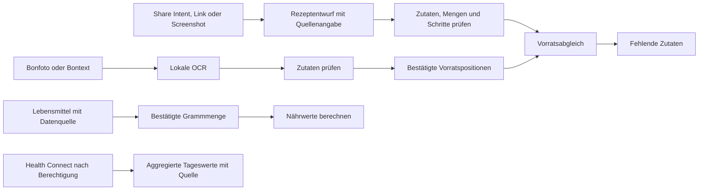

# Gemeinsames Domänenmodell

Stand: 1.2.1. Implementiert in `Domain.kt` und `lib/domain.ts`. Das bestehende Küchenjournal bleibt bei Format 2; Gesundheitsdaten werden nicht ungefragt in dessen Cloud-Sicherungen aufgenommen.

## Invarianten

- Lebensmittelidentität und Zubereitungszustand gehören zusammen. Rohe und gekochte Nudeln beziehungsweise Reis sind unterschiedliche Einträge.
- Ein Bon belegt einen Einkauf, keine verzehrte Portion. Erkennung und Fotoauswertung liefern überprüfbare Vorschläge.
- Nährwerte beziehen sich ausdrücklich auf 100 g. Ohne bestätigte Grammmenge werden Stück oder Milliliter nicht in Gramm umgerechnet. Unbekannte Werte bleiben `null`.
- Vorratspositionen tragen Mengen, Datumsart und Herkunft. Alte bestätigte Zutaten werden als vorhanden mit unbekannter Menge übernommen; das bisherige Aufbrauchdatum ist eine Erinnerung.
- Abgelaufene Verbrauchsdaten schließen Positionen aus. Ein überschrittenes Mindesthaltbarkeits- oder Erinnerungsdatum wird nicht mit einem Verbrauchsdatum gleichgesetzt.
- Der Abgleich unterscheidet vorhanden, fehlend, unzureichende Menge und unbekannte Menge. Unbestätigte OCR-Ergebnisse zählen nicht als Vorrat. Doppelte Rezeptzutaten werden vor dem Mengenabgleich zusammengeführt.
- Social-Import speichert Quellenhinweise und benötigt eine bewusste Prüfung. Links werden nur validiert; die Foundation lädt weder Videos noch geschützte Beiträge herunter und umgeht keine Zugangskontrollen.
- `balanced` und `comfort` sind Interpretationsmodi. Sie liefern für sich keine Nährwert- oder Gesundheitsbehauptung.
- Health-Connect-Tageswerte enthalten Quelle und Datum. Fehlende Berechtigung oder fehlende Messung bleibt unbekannt. Spätere Anbindungen verwenden die aggregierten Providerwerte, um parallele Datenquellen nicht doppelt zu zählen.

## Nächste Anbindungen

Lebensmittelsuche und Nährwertquellen, native Health-Connect-Berechtigungen sowie Social-Share-Intent und überprüfbare Extraktion bauen auf diesen Typen auf. Diese Foundation enthält noch keinen KI-Scan und liest noch keine Health-Connect-Daten.

## Rechtlicher Freigabestand

Zuerst Studio ist der gewünschte neue Arbeitsname; er bezeichnet keine nachgewiesene eingetragene Gesellschaft. Die private Anschrift und der Wohnort des Betreibers werden nicht veröffentlicht. Für die öffentliche Freigabe des erweiterten Gesundheitsangebots sind vollständige echte Anbieterangaben und geprüfte Datenschutz-/Einwilligungstexte noch offen. Es werden keine erfundenen Anschriften oder Registerangaben eingesetzt.
